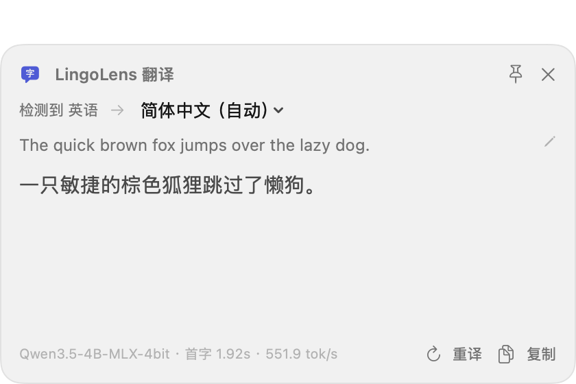
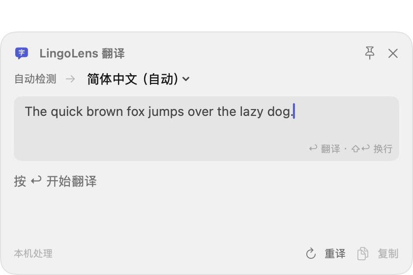
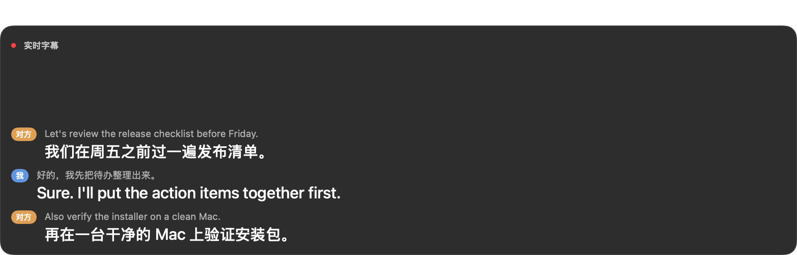
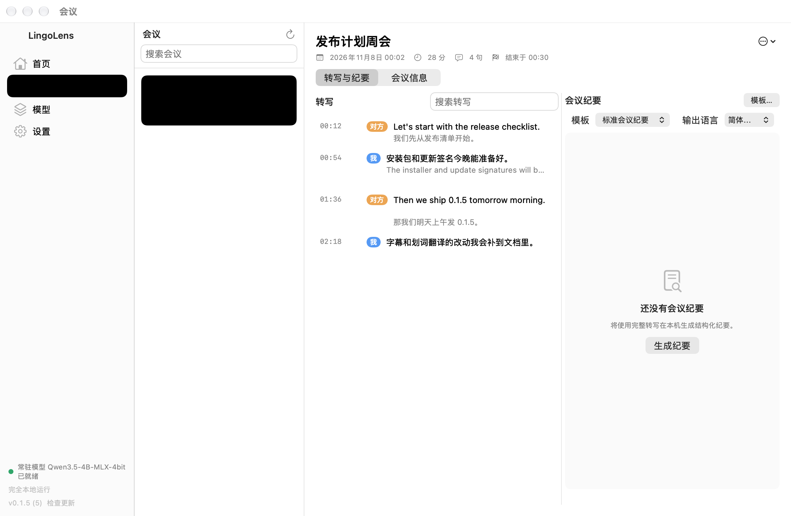
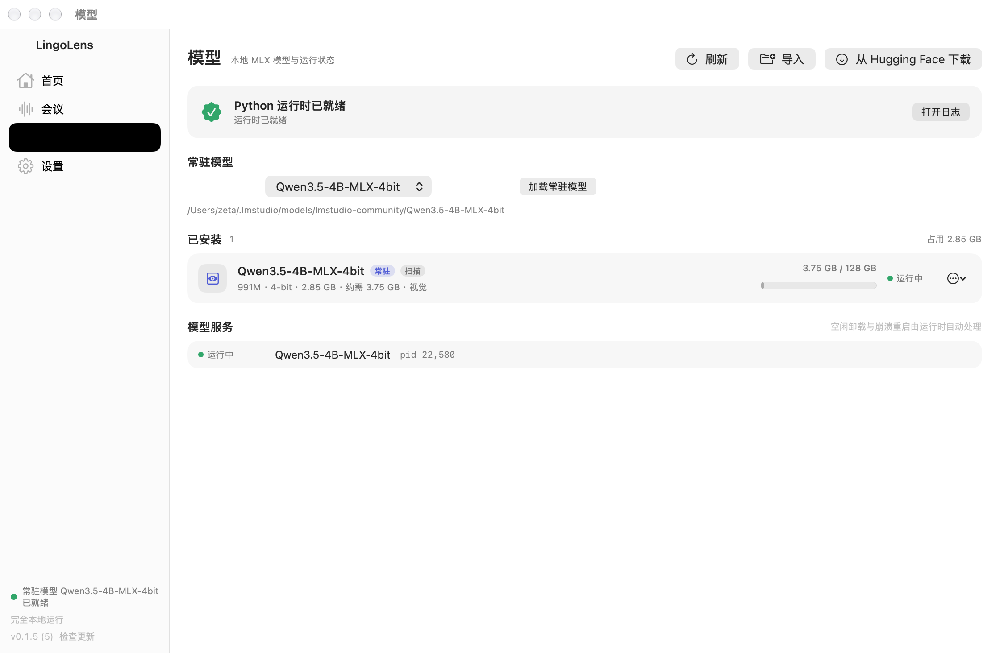
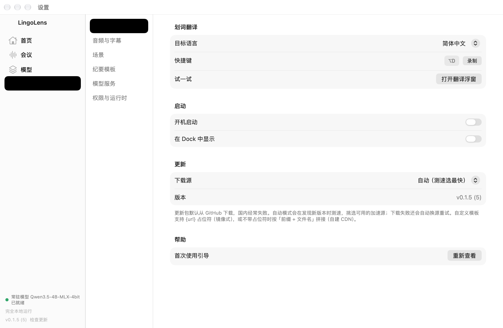

# LingoLens for macOS

完全本地运行的 macOS 翻译与会议助手：划词翻译、实时语音翻译、会议纪要。所有推理都在本机完成，不接入任何外部模型供应商。

设计文档见 [docs/specs/2026-11-05-lingolens-mac-design.md](docs/specs/2026-11-05-lingolens-mac-design.md)，
实现说明：[v1 桌面基础](docs/specs/2026-11-05-v1-implementation-notes.md)、
[v2/v3 音频与会议](docs/specs/2026-11-05-v2-v3-implementation-notes.md)。

## 功能

| 场景 | 说明 |
|---|---|
| **划词翻译** | 任意应用选中文字后按 `⌥D`（可在设置里录制修改）弹出浮窗，自动读取选中内容并流式翻译。原文可直接编辑，**直接按 `↩` 翻译**（`⇧↩` 换行），`Esc` 关闭，`⇧⌘C` 复制；浮窗可固定、随时切换目标语言。 |
| **实时双语字幕** | 菜单栏开启音频会话，系统音频与麦克风两路分别转写，按句流式翻译。字幕浮窗支持点击穿透、字号与透明度调节，适合网课、线上会议、外语视频。 |
| **会议纪要** | 转写实时落盘，结束后在会议页搜索、逐条校正、改标题；按模板流式生成纪要，可继续编辑、复制、保存。 |
| **本地模型** | 扫描 / 导入 / 下载 MLX 模型；常驻进程、空闲卸载、KV cache 量化、内存预检、崩溃重启。所有推理都在本机完成，不接外部模型供应商。 |
| **自动更新** | Sparkle 2 + GitHub Releases，下载前多源测速，失败自动换源重试。 |

## 界面

划词翻译浮窗：真实译文流式输出，底部显示模型、首字延迟与吞吐；原文可两行预览，点开即可编辑。

| 划词翻译 | 原文编辑（直接按 `↩` 翻译） |
|---|---|
|  |  |

实时双语字幕：对方 / 我两路转写逐句翻译，浮窗可点击穿透、调字号与透明度。



会议纪要：转写按时间落盘，右侧选模板在本机生成结构化纪要。



模型与设置：常驻模型、运行状态与内存占用一屏可见；划词快捷键、目标语言、更新源都在设置里。

| 模型 | 设置 |
|---|---|
|  |  |

> 截图为 v0.1.5 在 Apple Silicon / macOS 26 上的实际界面，模型为 Qwen3.5-4B-MLX-4bit。

## 当前进度

| 子项目 | 内容 | 状态 |
|---|---|---|
| v1 桌面基础 | App 外壳、ModelRuntime、ModelLibrary、LLMClient、Settings、SelectionTranslate | 已实现，Xcode 27.2 构建/测试通过 |
| v2 实时音频翻译 | AudioCapture、Transcriber、LiveSubtitle | 已实现（音频权限/设备需真机验证） |
| v3 会议纪要 | Meetings（转写落盘、列表、纪要生成） | 已实现（长会议分段、模板、导出） |

## 环境要求

- Apple Silicon，macOS 26 或更高
- 构建 App：Xcode 26 + [XcodeGen](https://github.com/yonaskolb/XcodeGen)（`brew install xcodegen`）
- 仅构建模块与运行单元测试：Command Line Tools 即可（`swift build` / `swift test`）

> `Package.swift` 只包含功能模块与测试；App 目标（SwiftUI）统一由 `project.yml`
> 用 Xcode 构建，以避免两套构建系统重复编译同一批源码。

## 构建

### 模块与测试

```bash
swift build
swift test
```

### App

```bash
# 1. 准备内置 uv（二选一）
#    下载 arm64 的 uv 放到 Resources/uv/uv（构建时会整体复制进 App），或
#    brew install uv —— 开发期会从 PATH / 常见路径回退查找
cp "$(which uv)" Resources/uv/uv

# 2. 生成工程并构建
xcodegen generate
xcodebuild -project LingoLens.xcodeproj -scheme LingoLens -configuration Debug build

# 或直接打开工程
open LingoLens.xcodeproj
```

若 Xcode 尚未安装到 `/Applications`（例如还在 `~/Downloads/Xcode.app`），
先按系统提示移到“应用程序”，或临时指定：

```bash
export DEVELOPER_DIR="$HOME/Downloads/Xcode.app/Contents/Developer"
```

安装好 Xcode 后建议执行一次：

```bash
sudo xcode-select -s /Applications/Xcode.app/Contents/Developer
```

App 为菜单栏常驻应用（`LSUIElement`），启动后不显示 Dock 图标，图标在屏幕右上角菜单栏
（`character.bubble`）。首次启动会自动打开主窗口；之后可点击菜单栏图标 → “打开主窗口”。

> 运行 `open` 时请确认当前目录是仓库根目录，或直接使用绝对路径：
> `open "$(pwd)/.xcodebuild/Build/Products/Debug/LingoLens.app"`。

## 首次使用

1. 启动后自动创建 Python 3.12 环境并安装固定版本的 mlx-vlm（进度显示在“模型”页）。
   首次需要下载约 220MB 依赖：默认优先国内镜像，单个源失败会自动回退官方 PyPI，
   界面显示当前包、已下载体积与已用时间。安装失败不会留下半成品状态，下次启动会
   自动重试（复用已下载的包）；也可以在「设置 → 权限与运行时」里换下载源或填代理。
   引导走到「选择模型」这一步时，若本机没有可用模型，会**自动开始下载**
   推荐的 Qwen3.5-4B-MLX-4bit（约 3 GB，从魔搭，实测 3.6–5.7 MB/s），
   完成后自动设为常驻模型，不需要手动选仓库。
2. 在“模型”页导入本地模型文件夹，或输入 Hugging Face 仓库 ID 下载。
3. 选择一个模型作为常驻模型，应用启动时会自动加载。
4. 在“设置 → 权限”中授予辅助功能权限（读取选中文本）。
5. 在任意应用选中文字，按 `⌥D`（可在设置中修改）弹出翻译浮窗；浮窗里可以直接改原文，
   按 `↩` 翻译（`⇧↩` 换行），不用组合键，`Esc` 关闭。
6. 在菜单栏选择“开始音频会话”，字幕浮窗会显示“对方/我”两路实时字幕；
   在“设置 → 音频会话”里选择来源、每路语言，并决定是否记录会议。
7. 菜单栏“记录会议”开启时，结束后到主窗口“会议”页查看转写、生成纪要。

### 中英混说识别不准怎么办

系统语音识别（SpeechAnalyzer）是「一句话一种语言」，中英混说时英文缩写常被按读音写成
汉字——实测 ES 会变成「淹死」，API latency 会变成 ATI LantonC。

在「设置 → 音频与字幕」里把识别引擎切到 **Whisper（本地，更准）**，首次需要下载约 464 MB
模型（从魔搭，实测 2.6 MB/s）。同一段音频的对照：

| 词 | 系统识别 | Whisper |
|---|---|---|
| API latency | ATI LantonC | API latency |
| deadline | dataline | deadline |
| feature | feture | feature |
| release | realase | release |
| beta | fito | beta |

代价：Whisper 按句出字幕，没有实时草稿；常驻内存约 0.73 GB。
「领域词表」里填 ES, API, PRD, deadline 这类缩写还能进一步提高命中率。

### 更新下载失败怎么办

- 更新包默认从 GitHub Releases 下载，国内可能超时或被重置。
- 「自动」模式下**镜像优先、官方兜底**（GitHub 直连常见「小请求能通、整包下载超时」，
  按速度择优反而会选中下不完的那个），下载失败会依次换到下一个源，直到成功或候选耗尽。
- 可以在「设置 → 通用 → 更新」里改成「仅官方」或填自建 CDN/镜像前缀
  （`https://gh-proxy.com/{url}` 是镜像式，`https://cdn.example.com/updates/` 是 CDN 式）。
- 完整性由 appcast 里的 EdDSA 签名校验，经过第三方镜像也不会被掉包。

### 首次安装卡住怎么办

- 默认走阿里云镜像，不需要代理；如果镜像也不通，会**自动**改用官方 PyPI 再试一次。
- 进度条上的「已用 3:20」「已下载 76 MB / 232 MB」是真实下载量；45 秒没有新输出会提示网络较慢。
- 可以在「设置 → 权限与运行时 → 依赖下载」换成清华/腾讯镜像、填自定义索引或 HTTP 代理。
- 依赖缓存在 `~/Library/Application Support/LingoLens/cache/uv`，取消或失败后重试不会从头下载。

模型扫描目录默认为 `~/mlx-models`、`~/.cache/huggingface/hub`、`~/.lmstudio/models`，
可在“设置 → 扫描目录”中增删。

## 目录结构

```
lingolens-mac/
├── Package.swift              # SwiftPM：功能模块 + 测试
├── project.yml                # XcodeGen：App 工程
├── App/                       # App 入口、菜单栏、主窗口、设置页
├── Modules/
│   ├── ModelRuntime/          # Python 环境、进程池、内存预检、PID 清理
│   ├── ModelLibrary/          # 扫描/导入/下载、模型信息解析
│   ├── LLMClient/             # SSE 流式客户端、场景生成参数
│   ├── Settings/              # settings.json、场景/服务/通用设置
│   └── SelectionTranslate/    # 全局快捷键、取词、翻译浮窗
├── Resources/uv/              # 内置 uv（构建时复制进 App）
├── Tests/                     # Swift Testing 单元测试
└── docs/specs/                # 设计文档与实现说明
```

## 本地数据

- 设置：`~/Library/Application Support/LingoLens/settings.json`
- 模型列表：`~/Library/Application Support/LingoLens/library.json`
- Python 环境：`~/Library/Application Support/LingoLens/runtime/`
- 下载的模型：`~/Library/Application Support/LingoLens/models/`
- 日志：`~/Library/Logs/LingoLens/<模型名>.log`
- 会议（v3）：`~/Library/Application Support/LingoLens/meetings/<日期-时间>/`
  - `meta.json` / `transcript.jsonl` / `minutes.md`
  - `audio-other.m4a` / `audio-me.m4a`（开启「同时保存音频」时；16 kHz 单声道，约 16 MB/小时）

## 测试

```bash
swift test
```

覆盖：模型目录识别与信息解析、safetensors 参数统计、扫描与列表持久化、SSE 增量解析、
场景参数合并与默认值、ServerPool 状态机（启动/复用/空闲卸载/租约/崩溃重启/内存拦截/超时/退出）、
Python 环境安装与版本变更重装、快捷键描述、翻译方向判定与提示词。

有真实模型时，可额外运行端到端集成测试（默认跳过）：直接调用 server、走完整的
`TranslationService` 链路，以及用真实模型生成会议纪要：

```bash
LINGOLENS_INTEGRATION_MODEL=~/mlx-models/Qwen3.5-4B-MLX-4bit swift test --filter Integration
```

语音转写可用本地生成的音频文件验证（默认跳过）：

```bash
say -v Tingting -o /tmp/zh.aiff "今天天气很好，我们下午三点开会。"
LINGOLENS_SPEECH_TEST_FILE=/tmp/zh.aiff LINGOLENS_SPEECH_LOCALE=zh-Hans \
  swift test --filter SpeechTranscriptionIntegrationTests
```

## 已知限制

- 仅本地签名运行，未做 Apple 公证（首次打开需要手动放行）；自动更新走 Sparkle + GitHub Releases。
- 实时音频/会议纪要已实现，但系统音频采集需要 TCC 授权，双路字幕与回声效果需真机手动验收。
- 音频设备选择、会议音频保存（m4a）尚未实现；字幕字号/透明度暂无 UI 控件。
- 固定版本的 mlx-vlm 服务参数（`--kv-bits`、`--max-kv-size`）以实际安装版本为准，
  如版本不支持可在服务参数中改用额外参数覆盖。
